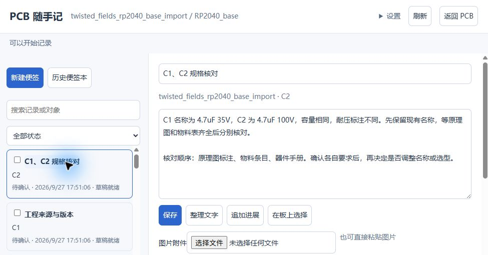
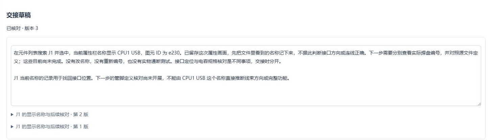
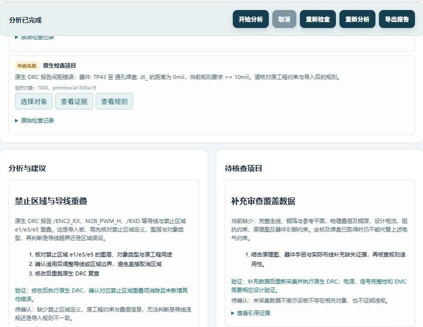

# 界面示例

以下为公开 RP2040 工程上的开发者使用记录。按各图原始版本标注，用于说明操作界面，不作为 v0.9.7 的全功能验收结论。

仅裁切面板，未改写文字或状态；公开副本已扁平化并移除图片元数据。PCB 背景与原图不随仓库发布。

## 规格便签与对象关联

版本 v0.9.5。

## 交接草稿与原文入口

版本 v0.9.4。

## 辅助设计检查的中文解释

版本 v0.9.6。

